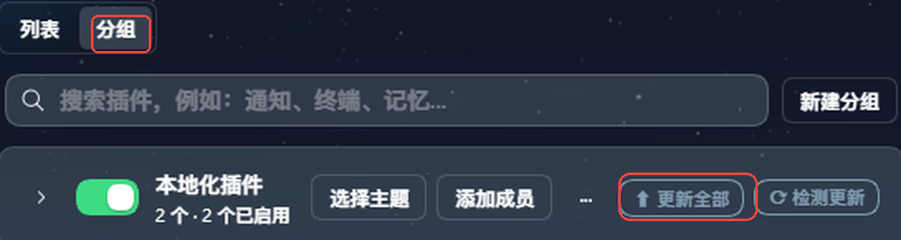
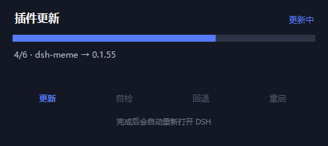
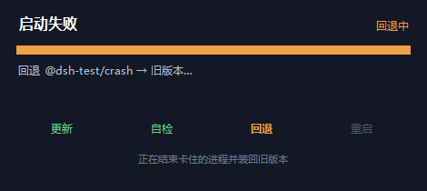
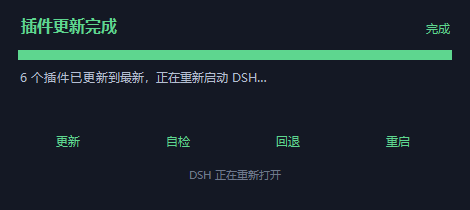

# dsh-market-expand

> 给 DSH 插件市场补三块缺口：**一键更新全部**、**更新失败自动回退**、**本地插件更新检测**。

## 这是什么（大白话）

DSH 的插件市场（`dshmarket`）已经很好用，但有三件事它自己做不了：

1. **更新它自己** —— 市场的更新流程是「先卸掉自己、再装新版本」。卸载那一步会把市场从运行中的组合里摘掉，后面「装新版本」的代码根本跑不到。所以官方提示永远是「退出 DSH，去命令行装，再打开」。
2. **更新带子进程的插件** —— 比如自带守护进程的插件，运行中更新会被文件占用顶回来。
3. **管不了本地插件** —— 用 `link:` 挂进来的本地开发插件，市场不检测它们的更新。

这个插件把这三件事接过来：**在 DSH 里点一下，退出 DSH，剩下的它自己做完，并把 DSH 开回来。**

## 你能得到

### 1. 一键更新全部

**按钮在哪**：市场的 **「分组」页面**，**顶部那一行**（搜索框和「新建分组」所在行）的右侧——**位置固定，不依赖任何分组**，第一次用也一眼能看到：



> 如果你用的是 v1.2.1 及更早版本，按钮挂在**分组头**上（「本地化插件」模块右上角）；从 v1.2.2 起改为固定在页面顶部。

点开后：

- 扫描当前 profile 里所有 npm 插件的 registry 最新版（**包括市场自己**）
- **`github:` 安装的插件也在范围内**：没有 npm 版本号可查的，就对比仓库的最高 semver tag
- 勾选要更新的 → 排队 → **右下角立刻弹出进度窗，显示「已排队 N 个，等待 DSH 退出」**
- 你从托盘右键退出 DSH
- 助手在后台用桌面端自带的 CLI 安装（失败自动回退 `pnpm`），并补写 `dsh.profile.bundles`
- 装完自动把 DSH 重新打开

点完没反应是旧版最大的问题——现在排队成功当场就有进度窗和「已排队 N 个」的按钮状态；排队期间再点按钮不会报错，而是打开排队详情（可以取消）。

### 2. 更新安全网（重点）

更新完重启，如果 DSH 起不来：

```
重启 → 60 秒自检 → 发现新的 crash-*-web-boot.log
  → 解析出是哪个插件崩的 → 只回退「本次更新过的」
  → 抢在「禁用全部插件」对话框被点之前结束进程
  → 装回旧版本 → 重启 → 再自检一次
```

**为什么需要**：桌面端启动失败会弹一个只有「禁用全部插件」按钮的窗口，点下去 `sanitizeProfile()` 会改名 patch 文件、重置 bundles —— 你的定制会全部失效。这个助手会在你点它之前，自己把问题处理掉。

如果新起的宿主进程提前退出（常见于旧实例的子进程还没退干净、被单实例锁顶掉），助手会等 8 秒确认是否已有实例接管，**不会像旧版那样直接放行**。

### 2.5 组合破坏检查（2026-10-21 新增）

有些插件更新后不会让 DSH 崩溃，却会把 **Agent 预设**弄没：它们的 `dsh.bundle.patch.yml` 会给官方 preset 注入某个服务，或者依赖自己 `insert` 的条目。一旦那个服务被你在 patch 里 `disabled: true`，四个 preset 会全部停在 pending —— 设置页「Agent 预设」整页空白、旧会话报 `Unknown agent preset: xxx`。

这类失败不写 crash log，启动自检看不见。所以更新完、重启前，助手会扫一遍本次更新包自带的 bundle patch，把风险点名写进日志和进度窗，例如：

```
⚠ 组合风险：billion-context 依赖自己 insert 的条目 "bili-native"，
  而你的 profile 把它禁用了 —— 可能导致插件或 preset 失效
```

更新前还会备份 `package.json` / `cordis.patch.yml` / `.dsh-market/state.json`，万一真被 sanitize 了也能捞回来。

### 3. 本地插件检测与快照

把 `link:` 插件放进市场的「本地化插件」分组，点 **⟳ 检测更新**：

- 按每个插件各自配置的 npm 包名或 GitHub 仓库比对版本
- 有更新时行内出现 **⬆**，升级走「自动快照 → 合并 → 校验」，冲突会转成「建议手动」
- 保留最近 3 份快照，出问题可一键回滚

## 进度看得见

点完按钮右下角就会弹一个原生小窗，**四步轨：更新 → 自检 → 回退 → 重启**，每个阶段换颜色，不用盯着黑屏猜它有没有在跑。

**v1.2.0 起**：

- **点完 1 秒内就弹**（显示「等待 DSH 退出」），不用等宿主退出才出现
- 窗口里**滚动显示真实日志行**（每条 `dsh plugin add … → ok/FAIL`）——DSH 关掉后，这是唯一能看到进度的地方
- **完成保留 60 秒、失败永久停留**（右上角 × 自己关）；旧版完成 3 秒就关，人一走开就错过
- 失败时在**桌面**写一份 `market-expand-更新失败-<时间>.txt`：失败包、自检结论、组合风险、日志和备份路径全在里面，DSH 起不来也不用翻 `.dsh`

<p align="center">
  
  
</p>
<p align="center">
  
</p>

左：更新中（蓝色，显示 `4/6 · 包名 → 版本`）  
右上：启动失败后自动回退（橙色，前两步已绿，正在回退肇事插件）  
右下：完成（全绿）

> 三张截图为 v1.0 的旧布局；v1.2 窗口更高，中间多了滚动的日志区。


## 和 dshmarket 的关系

**不是替代品，是补丁层。** `dshmarket` 负责「逛、装、卸、分组、备份、诊断」这些日常；本插件只补它做不了的三件事。两者可以同时安装，互不干扰。

## 安装

```sh
dsh plugin --profile <profile> add dsh-market-expand
```

官方桌面端请在应用自己的「设置 → 插件」里安装——那个 profile 归应用的插件管理器所有。

## 代理

检测 GitHub 源、查询 registry 时可能需要代理。本插件从环境变量读取，**不写死任何地址**：

| 变量 | 说明 |
|---|---|
| `DSH_GIT_PROXY` | 优先级最高，如 `http://127.0.0.1:7890` |
| `HTTPS_PROXY` / `HTTP_PROXY` | 标准变量，兜底 |
| `DSH_GIT_INSECURE=1` | 自签证书环境才需要，放宽 git 的 TLS 校验（默认不放宽） |

一个都没有就直连。也可以写在 `~/.dsh/.env` 里，插件启动时会自动读。

## 它动了哪些文件

只在需要更新时、且 DSH **完全退出之后**：

- `~/.dsh/market-expand/` —— 队列、报告、日志、更新前备份、进度状态
- 当前 profile 的 `package.json`（依赖与 bundles）与 `node_modules`
- 只**读** `crash-*-web-boot.log`，不修改
- 更新失败时在**桌面**写一份 `market-expand-更新失败-<时间>.txt`

不会碰你的 `cordis.patch.yml`、会话和记忆库。

## 版本历史

- **v1.2.2**（2026-10-21）：「⬆ 更新全部」改为固定在市场「分组」页顶部那一行（不再依赖分组），解决「装了插件却看不到按钮」；找不到顶部行时仍退回分组头。
- **v1.2.1**（2026-10-21）：排队面板加「⚡ 立即重启并更新」；进度窗改用 `conhost.exe` 启动（桌面端终于能看到）、贴右下角、实时滚动日志、关闭按钮无焦点框、成功后保留 5 分钟；按钮状态每 4 秒轮询；自检时长按包数动态（1 个 10 秒 → 10 个 30 秒）；README 加「更新按钮在哪」。
- **v1.2.0**（2026-10-21）：进度窗提前到点完即弹 + 实时日志行 + 完成 60 秒/失败常驻；新增**组合破坏检查**（识别会改写官方 preset inject、或依赖被禁用条目的更新包）；自检修正「宿主进程提前退出直接放行」；失败时桌面写报告；「更新全部」按钮挪进「本地化插件」分组；`/update` 不再二次扫描（避免静默丢包）；排队中可取消。
- **v1.0.0**（2026-10-21）：首个开源版，含一键更新全部 + 启动自检自动回退 + github 源支持。

## License

MIT
